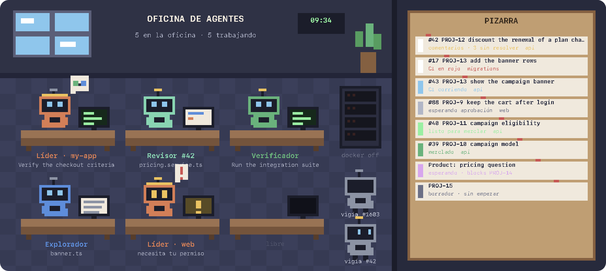

# Agent Office

A tiny pixel-art office that floats on your Mac desktop and shows what your
[Claude Code](https://claude.com/claude-code) agents are doing right now: the main
session, every subagent it launches, background watcher scripts and Docker.



*Una oficina pixelada que flota en tu escritorio y muestra en vivo qué hacen tus
agentes de Claude Code. La interfaz está en español. [Ver en español ↓](#en-español)*

## What you see

A small office seen from a three-quarter view, like a classic top-down RPG: a back wall
with a window (the real sky for the time of day), a clock, a coffee counter, a plant, a
door, a rug and six desks. Next to it sits a **machine room** with the dev infrastructure
that is running, and on the right wall a **cork board** with your pull requests.

- **One robot per agent.** The orange robot with a gold stripe is the lead (one per
  session, labelled with the project folder). Subagents get their own desk and color:
  green verifier (`ac-verifier`), blue explorer (`Explore`), purple helper
  (`general-purpose`), yellow clone (`fork`), cyan architect (`Plan`), teal reviewer.
  Unknown agent types show with their own name.
- Agents **walk in through the door** to their desk when they start, and **walk out**
  with a ✓ when they finish.
- **What each one is doing**, read from the tool it is using:

  | Activity | Monitor | Extra |
  |---|---|---|
  | Running commands (Bash, MCP tools) | green scrolling code | hands typing |
  | Reading (Read, Grep, Glob) | a page | eyes moving |
  | Editing (Edit, Write) | text being written | hands typing |
  | Browsing (WebFetch, browser, Figma, Linear) | a web page | |
  | Talking (Slack, mail, SendMessage) | purple chat | speech bubble |
  | Delegating (launching a subagent) | green code | two-boxes bubble |
  | Thinking (between tools) | moving dot | `…` bubble |
  | **Needs you** (permission prompt, question) | blinking `!` | red `!` bubble, raised hand, the desk glows |
  | Idle (turn finished) | screensaver | mug of coffee |

- **Your turn (Tu turno):** a red sign on top of the board lists everything that waits for
  you, oldest first, with how long it has waited ("hace 4 min"), and its bell rings while
  the list is not empty. The title plaque shows the count ("Tu turno: 2") so you can read it
  even at the small size.
  - A session that **finished its turn** and waits for your instructions (subagent stops
    do not count: the lead handles those). It clears when you write to it again.
  - A session that **asks for a permission** or **asked you a question**. It clears as soon
    as the session moves on.
  - On GitHub: pull requests where **your review is requested** and open **issues assigned
    to you** (for example a manual workflow approval). Click one of these rows to open it
    in the browser.
  - The lead whose turn ended raises its hand with a **"¡tu turno!"** sign and the minutes
    it has waited, and its desk glows gold (a permission keeps the red `!`).
  - **Avisos con sonido** (right-click menu, on by default): a macOS notification with a
    sound when something enters the list. Each item is announced once, items that arrive
    within 5 s go out together, and nothing is announced for what was already waiting when
    the office opened.
- **Machine room** (checked every ~10 s in the background; each probe is skipped when its
  tool is missing):
  - **Docker:** while Docker Desktop is open, a rack with one blinking light per running
    container (`docker ps`), named after its image (postgres, redis…). Docker closed
    leaves the rack dark; a daemon that does not answer shows "docker no responde".
  - **Phones:** Android emulators (by AVD name) and USB devices through `adb` (only when
    the adb server is already running, so it is never started for you), and booted iOS
    simulators (`xcrun simctl`, only while Simulator.app is open), each on a stand.
  - **Local servers:** your own TCP listeners below the ephemeral range (`lsof`), one
    little screen each with the port and a friendly name: Metro on 8081, web/vite/next/nest,
    postgres, redis, mysql… System and desktop apps are ignored.
  - **Watchers:** any running script named `watch_<number>.sh` stands there with
    binoculars as **vigía #number** (handy for "wait until the PR is green" loops).
- **Board (pizarra):** your pull requests with the stage each one is in, most urgent
  first: unresolved review comments, CI in red, changes requested, CI running, waiting for
  approval, ready to merge, draft, merged in the last 24 h. Rows that need you blink. A
  subagent whose task mentions "review" sits at a desk as **Revisor #PR**.

## Install

Requirements: macOS 13+, the Xcode Command Line Tools (`xcode-select --install`) and
`jq` (`brew install jq`).

```bash
git clone https://github.com/HackbIade/agent-office.git
cd agent-office
./install.sh               # or ./install.sh --autostart to open it at login
```

The installer:

1. Copies `hook.sh` to `~/agent-office/` and builds `AgentOffice.app` there.
2. Adds one **async** hook per event to `~/.claude/settings.json`, next to the hooks you
   already have (it keeps a backup in `settings.json.agent-office.bak`). Async hooks
   never slow Claude Code down.
3. Opens the office.

New Claude Code sessions report to the office right away. In a session that was already
open, run `/hooks` once so it reloads the settings.

**Using it:** drag it anywhere. Right-click for small, medium or large size, to turn the
sound notifications on or off, or to close it. Reopen it with `open ~/agent-office/AgentOffice.app`.
The menu bar icon shows or hides the office with a click (right-click opens the same menu),
and shows how many items wait for you, so you can keep the office hidden while you read.

## Uninstall

```bash
./uninstall.sh            # removes the hooks and the login item
./uninstall.sh --purge    # also deletes ~/agent-office
```

## How it works

```
Claude Code ──hooks (async)──▶ hook.sh ──▶ ~/agent-office/events.jsonl ──▶ AgentOffice.app
```

- `scripts/hook.sh` turns each hook event (session start and end, prompt, tool use,
  subagent start and stop, notification, stop, compaction) into one short JSON line.
  It keeps only the tool name and a short description, never file contents or tool
  output. The file trims itself at 2 MB.
- `src/AgentOffice.swift` is a single-file AppKit app with no dependencies. It reads new
  lines from the file, keeps a small state per agent and draws the office pixel by pixel.

**Light on resources:** the room and all the text are rendered once into a cached layer
and redrawn only when some text changes. Each frame draws only the sprites, at the art's
own resolution (296 × 164 pixels), and Core Animation scales them up with
nearest-neighbor. It runs at 6 fps while someone works (12 fps for the second a robot
walks), 1 fps when everyone is idle, and does not draw while the window is hidden. The
machine-room probes run on a background queue. Measured on an Apple Silicon Mac at the
medium size: about 1% of one core with six busy agents, 0.25% idle, about 45 MB of memory.

Everything stays on your Mac: no network, no telemetry.

### Board

`board.sh` runs every 2 minutes in the background through the GitHub CLI (`gh`, logged
in). It makes three GraphQL calls (your open and recently merged pull requests, and one for
review requests plus assigned issues) and writes `board.json`, with the "Tu turno" items
under `yours`. Without `gh` the board stays
empty. To narrow it, create `~/agent-office/board.conf`:

```bash
BOARD_QUERY="base:develop"              # extra GitHub search qualifiers
BOARD_TITLE_REGEX="PROJ-(12|13)[0-9]"   # keep only matching titles
```

These filters apply only to your own pull requests: review requests and assigned issues
always show up in "Tu turno".

Rows that are not pull requests (a pending decision, tickets not started) go in
`~/agent-office/tasks.json`:

```json
[{"title": "Waiting for product: pricing question", "stage": "waiting", "note": "blocks PROJ-123"}]
```

Stages: `comments`, `ci_red`, `changes`, `ci_running`, `approval`, `ready`, `draft`,
`merged`, `waiting`, `working`.

### Settings

- `AGENT_OFFICE_DIR`: where the events and the app live (default `~/agent-office`).
  Set it before `./install.sh`.
- To export the current frame as an image, touch `$AGENT_OFFICE_DIR/snap.request`; the
  app writes `snap.png` next to it.
- `AGENT_OFFICE_NOTIFY_LOG`: path to a file; notifications are appended there instead of
  shown (for demos and tests).
- `AGENT_OFFICE_DEMO_MACHINES`: path to a JSON file that replaces the machine-room probes
  (for screenshots and demos). See [`docs/demo-machines.json`](docs/demo-machines.json).

## En español

Una oficina en pixel art, vista en 3/4 desde arriba, que flota en el escritorio de tu Mac
y muestra qué hacen tus agentes de Claude Code: la sesión principal y cada subagente, cada
uno en su escritorio. Entran por la puerta cuando empiezan y salen cuando terminan; el que
necesita tu permiso levanta la mano, muestra un `!` rojo y su escritorio brilla.

- **Tu turno:** un letrero rojo arriba de la pizarra lista lo que espera por ti, lo más
  antiguo primero y con cuánto lleva esperando: sesiones que terminaron y esperan tus
  instrucciones, sesiones que te piden permiso o te hicieron una pregunta, PRs donde te
  piden revisión e issues asignados a ti (clic para abrirlos). El líder que espera levanta
  un letrero "¡tu turno!" y el título muestra "Tu turno: N". Con "Avisos con sonido" (clic
  derecho) recibes una notificación de macOS cuando algo entra a la lista.
- **Sala de máquinas:** lo que tienes corriendo para desarrollar. Un rack con una luz por
  contenedor de Docker, los emuladores de Android, dispositivos por USB y simuladores de
  iOS en su soporte, los servidores locales con su puerto (Metro 8081, web 3000, postgres,
  redis…) y los scripts vigías (`watch_<número>.sh`). Se revisa cada ~10 s en segundo plano.
- **Liviana:** alrededor de 1 % de un núcleo con seis agentes trabajando, 0,25 % en reposo
  y unos 45 MB de memoria.

- **Instalar:** `./install.sh` (o `./install.sh --autostart` para que abra al iniciar
  sesión). Necesitas macOS 13+, las Command Line Tools de Xcode y `jq`.
- **Desinstalar:** `./uninstall.sh` (con `--purge` borra también `~/agent-office`).
- Agrega hooks asíncronos a `~/.claude/settings.json` sin tocar los que ya tienes y
  guarda un respaldo. No frena a Claude Code y nada sale de tu Mac.
- La pizarra muestra tus PRs y en qué etapa está cada uno (comentarios, CI en rojo,
  esperando aprobación, listo, mezclado), con lo urgente primero. Se filtra con
  `board.conf` y se le agregan tareas a mano en `tasks.json`.
- Arrástrala donde quieras; con clic derecho cambias el tamaño o la cierras.
- El ícono de la barra de menús la muestra u oculta con un clic (clic derecho abre el menú) y muestra cuántas cosas esperan tu turno, aunque esté oculta.

## License

MIT. The robots and the office are original pixel art made for this project.
